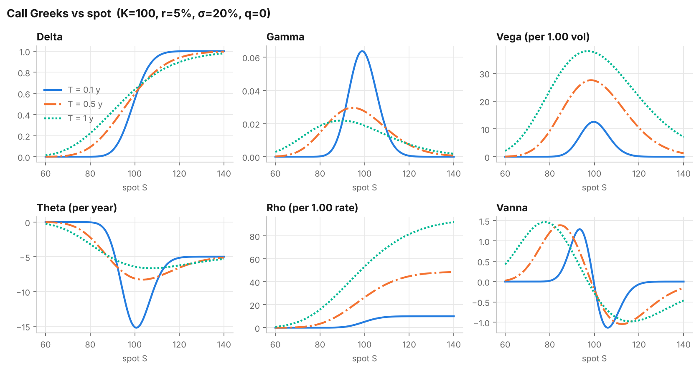
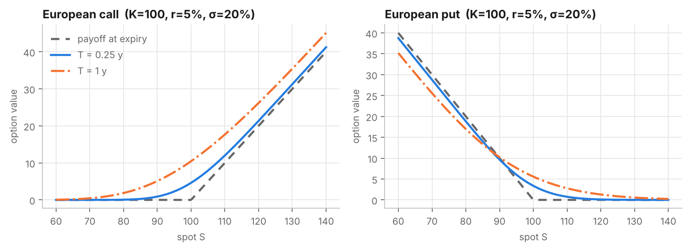
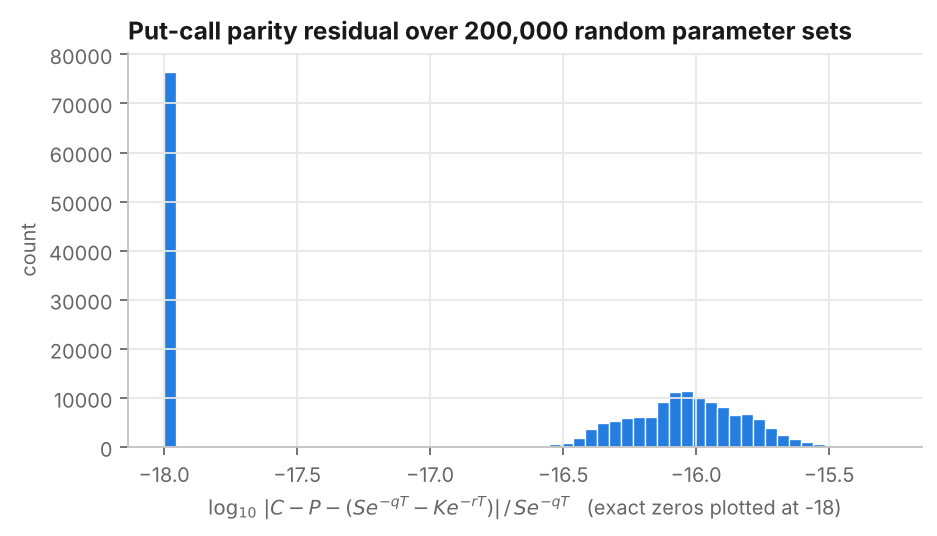
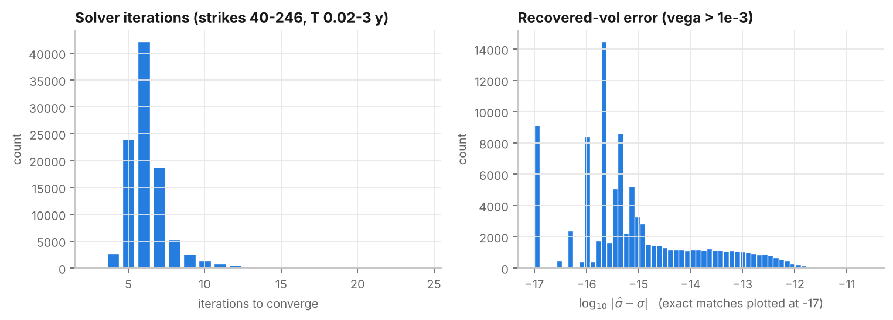

# Black-Scholes pricer: Greeks and implied volatility (Python + C++ + web demo)

[](https://github.com/Virinchi8/black-scholes-pricer/actions/workflows/ci.yml)

**[Live demo](https://black-scholes-pricer-virinchi8.vercel.app)**: change the inputs and watch prices, Greeks and implied volatility update.

A small, carefully tested implementation of the Black-Scholes-Merton model for European options, written three times: a vectorised **Python** package (NumPy/SciPy), a dependency-free **C++17** library with the same API and the same numerical method, and a dependency-free **JavaScript** port that powers an interactive web demo (`web/`).

- **Pricing** of calls and puts with a continuous dividend yield `q`.
- **Analytic Greeks:** delta, gamma, vega, theta, rho, plus the second-order vanna and volga.
- **Implied-volatility solver** that converges for every arbitrage-free quote, including far out-of-the-money wings where plain Newton fails, and says so honestly (`nan`) when a quote carries no volatility information.
- **Verification** against put-call parity, finite differences, textbook values, and **50-digit mpmath reference values**; the Python, C++ and JavaScript versions are all checked against the same reference files.

This is the first project in a series on quantitative finance; every number and figure below is reproduced by a script in this repo.

## Quick start

```bash
# Python
cd python
pip install -e ".[dev]"
pytest                                  # 80 tests
python scripts/make_results.py          # regenerates docs/*.png and docs/results.json
```

```python
import numpy as np
import bsm

bsm.price(100, 105, 0.5, 0.04, 0.25, "call", q=0.01)          # 5.548...
bsm.greeks(100, 105, 0.5, 0.04, 0.25, "put", q=0.01)           # dict of 7 Greeks
bsm.implied_vol(6.61, 100, 110, 0.5, 0.03, "call")             # ~0.35

# everything is vectorised and broadcasts; calls and puts can be mixed
K = np.linspace(80, 120, 9)
kinds = np.where(K < 100, "put", "call")
quotes = bsm.price(100, K, 1.0, 0.04, 0.3, kinds)
bsm.implied_vol(quotes, 100, K, 1.0, 0.04, kinds)              # -> 0.3 everywhere
```

```bash
# C++ (CMake >= 3.16, any C++17 compiler; no external dependencies)
cd cpp
cmake -S . -B build && cmake --build build
ctest --test-dir build --output-on-failure
./build/bsm_cli price call 100 100 1 0.05 0.2          # 10.450583572186
./build/bsm_cli iv    call 10.45 100 100 1 0.05        # 0.199984448011  (5 iterations)
./build/bsm_bench                                      # 1M prices / implied vols
```

## The model

With spot `S`, strike `K`, maturity `T` (years), rate `r`, volatility `σ` and dividend yield `q`, all continuously compounded:

```
d1 = [ ln(S/K) + (r − q + σ²/2) T ] / (σ √T),      d2 = d1 − σ √T

call = S e^{−qT} N(d1) − K e^{−rT} N(d2)
put  = K e^{−rT} N(−d2) − S e^{−qT} N(−d1)
```

Put-call parity, `C − P = S e^{−qT} − K e^{−rT}`, holds exactly for these formulas and is the main sanity check in the test suite. `T = 0` or `σ = 0` return the discounted forward intrinsic value, which is the correct limit.

### Greek conventions

Raw mathematical derivatives, **not** trader-scaled; this is a common source of off-by-100 mistakes, so it is stated explicitly:

| Greek | Definition | Trader scaling |
|---|---|---|
| delta | ∂V/∂S | none |
| gamma | ∂²V/∂S² | none |
| vega | ∂V/∂σ, per 1.00 (100 vol points) | divide by 100 for "per 1%" |
| theta | ∂V/∂t, per year (negative for long options) | divide by 365 for "per day" |
| rho | ∂V/∂r, per 1.00 (100 rate points) | divide by 100 for "per 1%" |
| vanna | ∂²V/∂S∂σ | none |
| volga | ∂²V/∂σ² | none |





## Implied volatility

Price is strictly increasing in σ (vega > 0), so the implied volatility is unique whenever it exists. The solver finds it with a **safeguarded Newton iteration** and two refinements:

1. **Bracketing.** Every iterate maintains a bracket `[lo, hi]` that provably contains the root. Any Newton step that leaves the bracket is replaced by a bisection step, so the iteration cannot diverge, which plain Newton can when vega is tiny.
2. **Work on the out-of-the-money side.** An in-the-money quote is converted by put-call parity into the equivalent out-of-the-money option: its price is the *time value* `quote − forward intrinsic value`. The volatility information lives in the time value, not in the intrinsic part.
3. **Newton on log-price.** Out-of-the-money prices behave like `exp(−c/σ²)` in the wings. Solving `ln(model) − ln(market) = 0` is far better conditioned than solving for the raw price; plain price-space Newton hit the iteration cap on quotes around 1e-60 in my first version, while the log-price version converges on prices as small as 1e-296.

The starting point is `max(½·√(2|ln(F/K)|/T), √(2π/T)·price/(S e^{−qT}))` (a scaled Manaster-Koltveit guess and the Brenner-Subrahmanyam at-the-money approximation). I compared it with a constant start and the unscaled guess on a wide grid; it needed the fewest iterations, though the differences were modest.

### When there is no answer, it says so

`implied_vol` returns `nan` (and `converged = False` in the C++ result) for quotes that cannot have an implied volatility:

- the price is at or below intrinsic value, or at or above the upper no-arbitrage bound (`S e^{−qT}` for a call, `K e^{−rT}` for a put), or is not finite;
- the implied volatility lies outside the search bracket `[1e-8, 10]` (configurable).

There is also a subtler case that is a property of floating point, not of the solver. For a deep in-the-money, short-dated option, the time value can be smaller than the rounding error of the quote itself (for example `1.4e-14` on a price of `28.94`): the price is intrinsic value to within rounding, so it contains no information about volatility. Such quotes are rejected: an in-the-money quote must have time value above `8 ε (S e^{−qT} + K e^{−rT})` (about 4e-13 on a spot of 100), the accuracy to which the intrinsic value can even be computed. In the tests this is explicit: quotes within rounding noise must return `nan`, and every quote above it must converge.

This rule exists because GitHub's CI caught a bug: the first version only rejected prices *at or below* intrinsic value. A quote one rounding step above intrinsic value returned `nan` or a meaningless volatility depending on whether the compiler fused multiply-adds (`-march=native`), and the benchmark's worst error (0.017) came from such quotes. It now passes on seven compiler/flag combinations including FMA, `-ffast-math` and ASan/UBSan.

## Results

All figures come from `python/scripts/make_results.py` (seeded) and the C++ test/benchmark output.

**Reference values.**

| Case | Call | Put |
|---|---|---|
| Hull textbook: S=42, K=40, r=10%, σ=20%, T=0.5 | 4.7594 | 0.8086 |
| ATM benchmark: S=K=100, r=5%, σ=20%, T=1 | 10.4506 | 5.5735 |

**Accuracy against 50-digit arithmetic** (600 random contracts in `data/reference.csv`, generated by `python/scripts/make_reference.py` with mpmath):

| | Python | C++ |
|---|---|---|
| price, max relative error | 9.0e-14 | 5.6e-14 |
| each Greek, max abs error ÷ max \|value\| | ≤ 7.6e-16 | ≤ 7.1e-16 |
| implied vol, max \|σ̂ − σ\| | 7.3e-13 | 7.3e-13 |

**Put-call parity** over 200,000 random parameter sets (S ∈ [20, 200], K/S ∈ [0.5, 1.8], T ∈ [0.01, 5], σ ∈ [0.03, 1.5], q ≥ 0): the largest relative gap is **5.2e-16**, i.e. rounding error.



**Greeks against finite differences** (fourth-order five-point stencil, 2,000 random contracts, error normalised by the largest value): delta 9.6e-7, gamma 8.3e-7, vega 2.0e-7, theta 3.8e-6, rho 6.7e-12, vanna 1.9e-6, volga 1.6e-6. These are limited by the finite-difference truncation error (the 50-digit comparison above is the real accuracy measure); they confirm that each analytic formula is the derivative of the price.

**Implied-vol solver** on 100,000 random contracts (strikes from 40 to 246 with S=100, T ∈ [0.02, 3], σ ∈ [0.05, 1.5], calls and puts, q = 1.5%):

- 98.98% of the quotes carry time value above rounding noise; **all of them converge**, with no failures. The rest are rejected as described above.
- Max recovered-vol error where the quote identifies σ (vega > 1e-3): **2.5e-11**.
- Iterations: mean 6.3, median 6, 99th percentile 12, max 24.
- Re-pricing the recovered σ reproduces the quote to a relative 1e-12 for 99.9% of quotes; the worst case is 4.5e-10, on quotes around 1e-296 where the pricing formula itself runs out of float64 range.



**Throughput** for 1,000,000 options, single thread, measured in the sandbox this repo was built in (indicative only; run it on your own machine):

| | Python (NumPy, vectorised) | C++ (-O2, scalar loop) |
|---|---|---|
| price | 0.07 s | 0.06 s |
| implied vol | 1.1 s | 0.6 s |

Vectorised NumPy is competitive for pricing; the C++ version is about twice as fast for implied vol. The point of the C++ port is a self-contained library with the same numerics and a command-line tool, not raw speed.

## Testing

`pytest` runs 80 tests; the C++ runner makes ~18,600 checks (random-parameter loops count each check); the JavaScript port has 13 tests (`cd web && npm test`). All are run in CI.

| Check | What it guards against |
|---|---|
| Put-call parity on random clouds and extreme parameters | pricing formula errors, sign mistakes |
| Hull and ATM textbook values | gross errors |
| No-arbitrage bounds, monotonicity in σ and S, convexity in K | an unphysical price surface |
| Greeks vs five-point finite differences | analytic-derivative errors |
| Call/put Greek relations from differentiating parity | call/put sign errors in Greeks |
| `T=0`, `σ=0` limits | degenerate-case handling |
| Implied-vol round trip over a moneyness × maturity × vol grid | solver correctness |
| Agreement with `scipy.optimize.brentq` | independent root-finder cross-check |
| Wings (prices ~1e-130), invalid and arbitrage-violating quotes | robustness; `nan`, never a wrong number |
| Quotes within a few ulps of intrinsic value | compiler-dependent answers (found by CI, see above) |
| 50-digit reference CSV in all three languages (plus a 50-digit normal-CDF table for the JavaScript port, which has no `erfc`) | cross-language correctness |
| C++ tests under -O0/-O2/-O3, `-march=native` (FMA), `-ffast-math`, ASan + UBSan | compiler- and flag-dependent behaviour; memory and undefined-behaviour bugs |

## Scope and limitations

- European options only; constant volatility, rate and dividend yield (Black-Scholes-Merton assumptions). American exercise, discrete dividends and stochastic volatility are out of scope here. The next projects in the series price options with trees, PDEs and Monte Carlo and compare them with this closed form.
- Black-Scholes assumes lognormal returns, so real markets show a volatility smile and skew that this model cannot produce; the implied-vol solver is what lets you *measure* that.
- Finite-difference checks use fixed steps, and σ-derivatives at very small σ need a smaller step (the price is strongly nonlinear in σ there), which is why the C++ test uses `1e-4` for them. A first version with `1e-3` flagged correct analytic vega and volga formulas as wrong. The error was in the check, not the formula.

## Repository layout

```
python/          bsm package, tests, scripts (make_results.py, make_reference.py)
cpp/             include/bsm/black_scholes.hpp, src/, tests/, bench/, CMakeLists.txt
web/             interactive demo (index.html, src/bsm.js port, tests/)
data/            reference.csv: 600 contracts; normcdf_reference.csv: 193 points, both 50-digit ground truth
docs/            figures and results.json produced by make_results.py
.github/         CI (Python tests, C++ build/tests/sanitizers, JavaScript tests)
```

## License

MIT, see [LICENSE](LICENSE).
